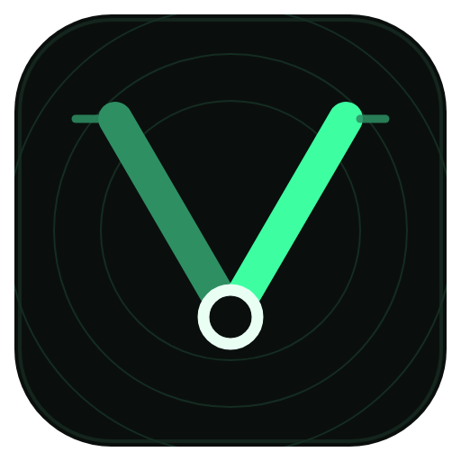
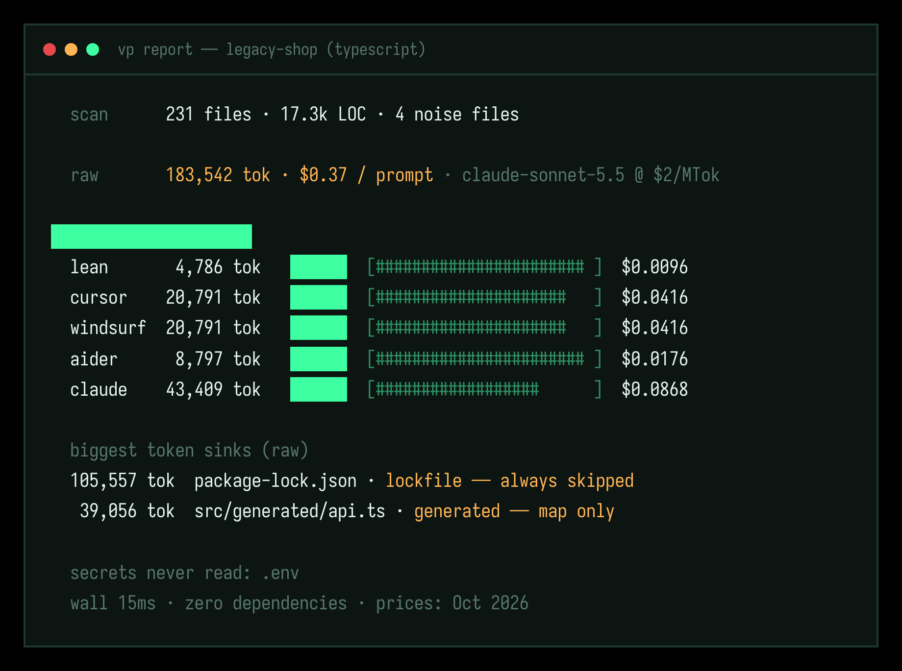

<p align="center">
  
</p>

<h1 align="center">vibe-pilot</h1>

<p align="center"><strong>The context optimizer for AI engineers.</strong></p>

<p align="center">
  <a href="https://github.com/Gatsuke/vibe-pilot/actions/workflows/ci.yml"></a>
  <a href="https://crates.io/crates/vibe-pilot"></a>
  <a href="https://crates.io/crates/vibe-pilot"></a>
  <a href="https://deps.rs/repo/github/Gatsuke/vibe-pilot"></a>
  
  <a href="LICENSE"></a>
</p>

```text
██╗   ██╗██╗██████╗ ███████╗
██║   ██║██║██╔══██╗██╔════╝
██║   ██║██║██████╔╝█████╗
╚██╗ ██╔╝██║██╔══██╗██╔══╝
 ╚████╔╝ ██║██║  ██║███████╗
  ╚═══╝  ╚═╝╚═╝  ╚═╝╚══════╝
            ██╗██████╗ ███████╗████████╗██╗██╗   ██╗███████╗
            ██║██╔══██╗██╔════╝╚══██╔══╝██║██║   ██║██╔════╝
            ██║██████╔╝█████╗     ██║   ██║██║   ██║███████╗
       ██╗  ██║██╔═══╝ ██╔══╝     ██║   ██║██║   ██║╚════██║
       ╚█████╔╝ ██║     ███████╗   ██║   ██║╚██████╔╝███████║
        ╚════╝  ╚═╝     ╚══════╝   ╚═╝   ╚═╝ ╚═════╝ ╚══════╝
```

---

Your AI coding assistant is eating your repo whole. A single `package-lock.json` is **100k+ tokens**. Generated API clients, vendor trees, boilerplate comments — all of it goes into the prompt, and you pay for it on every request, or you hit the context window and the model quietly forgets your codebase exists.

**vibe-pilot prunes your codebase into a hyper-focused `.context` file before you feed it to Cursor, Claude Code, Windsurf, or Aider.** It deletes the noise, ranks what matters for what you're building right now, and shows you exactly how many dollars it just saved you.

```text
$ vp report

  scan          231 files · 17.3k LOC · 4 noise files (lock/generated/binary)
  raw           183,542 tok est · $0.37 / prompt · claude-sonnet-5.5 @ $2/MTok

  profile projections
    lean         4,786 tok   -97.4%  [####################### ]  $0.0096
    cursor      20,791 tok   -88.7%  [#####################   ]  $0.0416
    aider        8,797 tok   -95.2%  [####################### ]  $0.0176
    claude      43,409 tok   -76.3%  [##################      ]  $0.0868

  biggest token sinks (raw)
     105,557 tok  package-lock.json · lockfile — always skipped
      39,056 tok  src/generated/api.ts · generated — map only

  wall 15ms · zero dependencies · prices: Oct 2026
```



*Every number above is real, measured on the reproducible fixture in [`bench/`](bench/) — run `make bench` and see for yourself.*

## The math nobody does

At 40 prompts a day on Claude Sonnet 5.5, that "small" app above burns **$0.37 of input on every prompt** — **$296/month** just to re-explain the same repo to the same model. On Opus 5.5 it's $592/month. Switch to the `cursor` profile and the same repo costs **$0.04 a prompt**. The lockfile was never going to help the model fix your bug.

vibe-pilot makes the invisible bill visible, then makes it smaller.

## Install

```bash
# npm / npx — works everywhere Node works (prebuilt binary, no compile)
npm i -g vibe-pilot

# or the 5-second curl installer (macOS / Linux release binary)
curl -fsSL https://raw.githubusercontent.com/Gatsuke/vibe-pilot/main/install.sh | bash

# or cargo — zero dependencies means this compiles in seconds, not minutes
cargo install vibe-pilot

# or from source
git clone https://github.com/Gatsuke/vibe-pilot && cargo install --path vibe-pilot
```

Don't want a global install? `npx vibe-pilot report` works too. The npm package is a thin launcher: it drops the prebuilt `vp` binary for your platform (macOS arm64/x64, Linux arm64/x64, Windows x64) and otherwise adds nothing.

The binary is `vp`. Thirty seconds to your first receipt:

```bash
vp report                            # see your token bill
vp prune --profile cursor            # write .context (the pruned repo)
vp context fix the session refresh bug   # task-focused context
```

## How it works

```
   your repo                vibe-pilot                         .context
┌──────────────┐   ┌───────────────────────────────┐   ┌──────────────────┐
│ 231 files    │   │ 1. WALK      gitignore-aware  │   │ stats + receipt  │
│ 183k tokens  │──▶│ 2. CLASSIFY  lock/gen/secret  │──▶│ scored file map  │
│ $0.37/prompt │   │ 3. RANK      task·git·imports │   │ pruned file      │
│              │   │ 4. BUDGET    profile caps     │   │ bodies (top-N)   │
└──────────────┘   └───────────────────────────────┘   └──────────────────┘
```

**Ranking is boring on purpose** — and fully documented in [`docs/CONTEXT-SPEC.md`](docs/CONTEXT-SPEC.md):

```
score = 3.0·task_relevance + 2.0·git_recency + 1.5·import_centrality
      + 1.0·path_proximity   + entry/rules/manifest bonuses
```

Files you touched this week outrank files you forgot in 2023. Files your task mentions outrank everything. Lockfiles, generated code, and binaries never make it in — but they all stay visible in the map, priced in tokens, so nothing is hidden from the model. It can ask for any file by path.

## Profiles

| Profile | Budget | Comments | Tests | Docs | For |
| --- | --- | --- | --- | --- | --- |
| `lean` | 8k tok | stripped | no | no | tiny windows, quick asks |
| `cursor` | 24k tok | kept | no | yes | Cursor's effective attention |
| `windsurf` | 24k tok | kept | no | yes | Windsurf + rules files |
| `aider` | 12k tok | stripped | no | no | repo-map style workflows |
| `claude` | 60k tok | kept | yes | yes | Claude Code's big window |
| `full` | no cap | kept | yes | yes | everything except noise |

Override any budget in `vibe-pilot.toml` (`vp init` writes one for you):

```toml
[vp]
profile = "claude"
model = "claude-sonnet-5.5"
ignore = ["docs/legacy/", "fixtures/"]

[profiles.lean]
max_tokens = 4096
```

## Benchmarks

Reproducible: `make bench` (fixture generator in [`bench/gen.sh`](bench/gen.sh), binary from this repo, nothing else).

**legacy-shop** — 231-file TypeScript app, 17.3k LOC, one lockfile, one generated API client:

| Profile | Tokens | Reduction | Cost / prompt | Saved / 40 prompts·day |
| --- | ---: | ---: | ---: | ---: |
| raw paste | 183,542 | — | $0.3671 | — |
| `lean` | 4,786 | **-97.4%** | $0.0096 | **$143 / month** |
| `aider` | 8,797 | **-95.2%** | $0.0176 | $140 / month |
| `cursor` | 20,791 | **-88.7%** | $0.0416 | $130 / month |
| `claude` | 43,409 | **-76.3%** | $0.0868 | $112 / month |

*(Sonnet 5.5 input pricing, Oct 2026. On Opus 5.5 ($4/MTok) the cursor-profile saving is ~$260/month.)*

**vibe-pilot on itself** — 30 files, 5.2k LOC: 11 ms full scan, -81.7% at `lean`.

**Speed**: 15 ms to walk + classify + rank + project all six profiles on the 231-file fixture (release build, M-class laptop). Zero dependencies, so `cargo install` takes seconds and the dependency tree adds exactly nothing to your audit surface.

## MCP: let your agent call vibe-pilot itself

```bash
# Claude Code
claude mcp add vibe-pilot -- vp mcp
```

```jsonc
// Cursor / any MCP client — .cursor/mcp.json
{
  "mcpServers": {
    "vibe-pilot": { "command": "vp", "args": ["mcp"] }
  }
}
```

Your agent gains four tools: `vp_report`, `vp_prune`, `vp_context`, `vp_diff`. A typical loop — ask Claude to `use vp_context` before a big change and `vp_diff` between prompts — keeps context lean without you thinking about it.

## The `.context` format

One markdown file. Stats receipt, task focus, git changes, a **complete scored map of every file**, and pruned bodies of the winners:

```markdown
## map
- `src/auth/session.ts` · source · 81 tok · score 4.8
- `CLAUDE.md` · rules · 18 tok · score 3.2
- `package-lock.json` · lockfile · 105k tok · NOT included (lockfile — always skipped)

## files
### `src/auth/session.ts` — 81 tok · score 4.8
```ts
// session handling — we are fixing the refresh bug here
export type Session = { id: string; token: string; exp: number };
...
```
```

It is an open spec ([`docs/CONTEXT-SPEC.md`](docs/CONTEXT-SPEC.md)). Adopt it, generate it with your own tooling, argue about the scoring formula — the format is deliberately boring markdown so every agent on earth can already read it.

## Safety

- **Secrets are never read.** `.env`, `*.pem`, keys, credentials — detected by name, skipped before a single byte touches memory, still priced in the raw total so you know what a leak would have cost.
- **Comment stripping is conservative.** Full-line comments only (a `//` inside a string can't start a line), lint directives like `// eslint-disable` always survive, and pruning never changes program meaning. Test-enforced.
- **Nothing is deleted.** vibe-pilot writes one new file (`.context`) and reads everything else. Add `.context` to `.gitignore`.

## Commands

| Command | What it does |
| --- | --- |
| `vp report` | token + cost analysis, per-profile projections, biggest sinks (`--json` for machines) |
| `vp prune` | write `.context` using a profile |
| `vp context <task...>` | rank the repo around what you're about to build |
| `vp diff` | only what changed vs HEAD — the between-prompts refresh |
| `vp mcp` | run as an MCP stdio server |
| `vp init` / `vp profiles` | config file / list profiles |

## Why not just…

| Tool | What it does | What vibe-pilot does differently |
| --- | --- | --- |
| `cat` / paste | everything, every time | measures the bill, then cuts it |
| [repomix](https://github.com/yamadashy/repomix) | packs the repo for AI | packer, not pruner: no ranking, no budgets, no cost receipt |
| `.cursorrules` / `CLAUDE.md` | static instructions | per-task, ranked, generated fresh |
| your IDE's indexing | helps the IDE, not the prompt | works on the prompt itself, any assistant |
| prompt caching | discounts *repeated* context | shrinks the context *before* it's ever sent (they stack) |

## Roadmap

- [ ] `vp watch` — regenerate `.context` on save
- [ ] AST-aware pruning (tree-sitter, behind a feature flag — the zero-dep core stays)
- [ ] Embeddings-free semantic ranking v2 (still no runtime deps)
- [ ] `vp bench` — track your repo's context weight over time in CI
- [ ] Homebrew tap + winget

## Contributing

PRs welcome — read [`CONTRIBUTING.md`](CONTRIBUTING.md) first. The one rule: **zero runtime dependencies.** It's the whole point.

## License

MIT — see [LICENSE](LICENSE).
